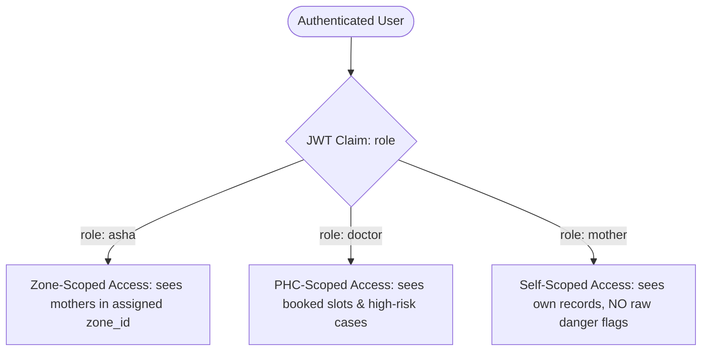

# Taara / Sakhi: Backend Handoff Pack

> **Version:** 2.0.0-pilot  
> **Target Release:** Pilot Production Handoff  
> **Clinical Governance:** Adarsh (Clinical Lock: 24 questions & PE-01 to AN-01 rules locked)  
> **Engineering Governance:** Tilin (marked "fixed") · Nuthana (field-test "verified")

---

## 1. Screen Data Contracts (Read & Write)

The frontend application is built with Expo Router (`app/src/app/`). Below is the complete typed contract for every screen across all roles, mapping exact data read and written.

### 1.1 Onboarding & System Screens

| Route | Reads (Query / Store) | Writes (Mutation / Action) | TypeScript Payload / Interface |
|---|---|---|---|
| `/welcome` | None (static brand assets) | Navigates to `/(onboarding)/role` | N/A |
| `/(onboarding)/role` | Device role state | Sets current role (`asha` \| `doctor` \| `mother`) | `{ role: 'asha' \| 'doctor' \| 'mother' }` |
| `/(onboarding)/language` | `i18n.locale` (`kn` \| `hi` \| `en`) | `setLocale(lang)` | `{ lang: 'kn' \| 'hi' \| 'en' }` |
| `/(onboarding)/auth` | Session auth state | Phone OTP verification; sets staff/mother token | `{ phone: string, otp: string }` |
| `/profile` | Current staff/user profile, demo state | `store.resetDemo()` | Resets state to baseline mock |

### 1.2 ASHA Worker Portal (`/asha`)

| Route | Reads (Query / Store) | Writes (Mutation / Action) | TypeScript Payload / Interface |
|---|---|---|---|
| `/asha/` (Home / Dashboard) | `useAshaMothers(ashaId)`, `useNotices(ashaId)`, `careStatus(mother)` | Navigation to zone or mother details | N/A |
| `/asha/add` | `ZONES` for current ASHA | `store.addMother(input)` | `NewMother`: `{ name: string, months: number, language: Lang, zoneId: string, phone?: string }` |
| `/asha/edit/[id]` | `useMother(id)` | `store.updateDetails(id, input)` | `MotherDetails`: `{ name: string, months: number, language: Lang, zoneId: string, phone?: string }` |
| `/asha/mother/[id]` | `useMother(id)`, `riskOf(mother)`, `activeBooking(id)` | `store.setFlag(id, flag)`, `store.setEscalation(id, note, by)` | `{ flag: 'well' \| 'needs_care' }`, `{ note: string, by: string }` |
| `/asha/session/[id]` (Talk with Sakhi) | `useMother(id)`, Audio Mic stream | `store.startCheckIn(id, visit)`, `store.recordTurn(id, turn)`, `store.recordReferral(id, ref)` | `AnswerRecord`: `{ value: string, danger: boolean, signs?: Sign[], confidence?: number }` |
| `/asha/review/[id]` | `mother.draft`, `transcripts.get(id)`, `evaluate()` | `store.updateAnswer(id, qid, record)`, `store.completeCheckIn(id, reportId)` | `CheckInReport`: `{ id: string, when: string, asha: string, high: boolean, rules: string[], answers: Record<string, AnswerRecord>, transcript: TranscriptLine[], visit: Visit }` |
| `/asha/clinical/[id]` | `useMother(id)`, previous vitals | `store.saveClinical(id, input)` | `ClinicalEntry`: `{ visit: Visit, fields: Record<string, ClinicalField>, tests: Record<string, LabTest>, by: string, at: number }` |
| `/asha/summary/[id]` | `useMother(id)`, `mother.reports[0]`, `generateReportPdf(doc)` | Shares PDF via OS sheet; triggers Doctor Booking navigation | `ReportDocument` for PDF generation |
| `/asha/zone/[id]` | Mothers filtered by `zoneId` | Filter by `careStatus` | N/A |
| `/asha/today` | Mothers due today or high risk | Booking navigation, call intent | N/A |
| `/asha/visits` | Mother ANC schedule | Reminders, visit logging | N/A |
| `/asha/reminders` | `useNotices()` for ASHA | Mark notices as read | `{ noticeId: string, read: boolean }` |
| `/asha/messages` | ASHA-doctor consult thread | `network.addComment(bookingId, text)` | `{ bookingId: string, text: string, byId: string }` |
| `/asha/direct` | LiveKit session token | Audio WebRTC stream | Audio PCM frames / LiveKit data packets |

### 1.3 Doctor PHC Portal (`/doctor`)

| Route | Reads (Query / Store) | Writes (Mutation / Action) | TypeScript Payload / Interface |
|---|---|---|---|
| `/doctor/` (Dashboard) | `useMothers()`, `state.slots`, `state.bookings` | Quick filter (Needs care / Today's OPD) | N/A |
| `/doctor/cases` | High-risk mothers (`riskOf(m).high`) | Triage filter | N/A |
| `/doctor/case/[id]` | `useMother(id)`, `m.reports`, `m.clinical`, `m.vitals` | `store.sendAdvice(id, advice)`, `store.confirmReferral(id, advice)` | `{ advice: string[], by: string }` |
| `/doctor/slots` | `state.slots`, `state.usual[doctorId]` | `network.openTimes()`, `network.setUsual()`, `network.removeSlot()`, `network.closeDay()` | `UsualWeek`: `{ weekdays: number[], session: Session, minutes: number }` |
| `/doctor/reports` | All filed `CheckInReport`s | PDF export / view | N/A |
| `/doctor/inbox` | Escalations and booking notices | Mark read, reply comment | `{ bookingId: string, comment: string }` |

### 1.4 Mother Portal (`/mother`)

| Route | Reads (Query / Store) | Writes (Mutation / Action) | TypeScript Payload / Interface |
|---|---|---|---|
| `/mother/(tabs)/index` (Home) | `useMother(id)`, `m.advice`, `m.vitals` (neutral view) | Audio TTS playback ("Listen to my results") | N/A |
| `/mother/(tabs)/pregnancy` | Gestational timeline, baby milestones | Educational interaction | N/A |
| `/mother/(tabs)/history` | Past check-in dates, vitals trends | N/A (calm read-only numbers) | N/A |
| `/mother/(tabs)/talk` | Direct voice guidance / FAQ | Audio query | LiveKit audio |
| `/mother/doctors` | Open doctor slots at local PHC | `network.bookSlot(slotId, mother, { kind: 'mother' })` | `{ slotId: string, motherId: string }` |
| `/mother/notifications` | Care circle alerts, visit reminders | Mark read | `{ id: string }` |
| `/mother/health` | Vitals charts (Sys/Dia, Hb, Weight) | N/A | N/A |
| `/mother/topic/[id]` | Pre-curated antenatal health topics | Audio TTS playback | N/A |

---

## 2. Data Layer Functions Specification

Located in `app/src/data/store.ts` and `app/src/data/care-network.ts`.

### 2.1 Screening & Mother Management (`store.ts`)

```typescript
// Start a voice check-in (initializes draft in memory)
startCheckIn(id: string, visit: Visit): void

// Record an answered turn from voice agent or testing tools
recordTurn(id: string, turn: { qid: string; record: AnswerRecord; text?: string; sub?: string }): void

// Correct an answer during review before filing
updateAnswer(id: string, turn: { qid: string; record: AnswerRecord }, reportId?: string, latest?: boolean): boolean

// Finalize check-in, evaluate rules, compute high-risk flag, archive report
completeCheckIn(id: string, reportId: string): void

// Register new mother into ASHA's zone
addMother(input: NewMother): string // returns generated motherId

// Update existing mother demographics
updateDetails(id: string, input: MotherDetails): boolean

// Set ASHA override condition ('well' | 'needs_care')
setFlag(id: string, flag: 'well' | 'needs_care'): void

// Escalate case to PHC Medical Officer
setEscalation(id: string, note: string, by: string): void

// DPDP Act 2023 affirmative consent logging
recordConsent(id: string, input: { granted: boolean; by: string; lang: string }): void

// Schedule 6-hour blood pressure recheck (Rule PE-01)
scheduleBpRecheck(id: string, input: { by: string; bp: string }): void

// Save manual clinical measurements, examination findings, and lab tests
saveClinical(id: string, input: {
  visit: Visit;
  fields: ClinicalEntry['fields'];
  tests: ClinicalEntry['tests'];
  by: string;
}): void

// Record urgent clinical referral during session
recordReferral(id: string, r: Omit<Referral, 'at'>): void

// Doctor sends structured advice steps
sendAdvice(id: string, advice: string[], by?: string): void

// Doctor confirms PHC referral
confirmReferral(id: string, advice: string[], by?: string): void

// Reset local storage to initial mock state
resetDemo(): void
```

### 2.2 Care Network & Slot Scheduling (`care-network.ts`)

```typescript
// Open doctor OPD slots across selected days
openTimes(doctorId: string, days: number[], session: Session, minutes: number): number

// Persist doctor recurring schedule
setUsual(doctorId: string, usual: UsualWeek): void

// Close single unbooked slot
removeSlot(slotId: string): void

// Close entire OPD day
closeDay(doctorId: string, day: number): number

// Book consultation for mother (idempotent, prevents double-booking)
bookSlot(
  slotId: string,
  mother: { id: string; zoneId?: string; name: string },
  by: Actor,
  note?: string
): { ok: boolean; reason?: 'taken' | 'too_soon' | 'has_visit' | 'not_yours' }

// Cancel scheduled appointment
cancelBooking(bookingId: string, by?: Actor['kind'] | 'doctor', motherName?: string): void

// Dispatch ASHA visit reminder notification
remindVisit(bookingId: string, note?: string): boolean

// Add discussion comment on booking thread
addComment(bookingId: string, text: string, byId: string, from: 'asha' | 'doctor'): boolean
```

---

## 3. Mock Data Replacement Inventory

| In-Memory Mock Item | File & Line | Target Supabase Table / RPC | API Endpoint / Architecture Replacement |
|---|---|---|---|
| `initial` Mothers Array | `store.ts:185` | `public.patients`, `public.patient_records` | `GET /rest/v1/patients?zone_id=eq.{zoneId}` with RLS |
| `transcripts` Map | `store.ts:390` | `public.check_in_transcripts` | Post-session write to Supabase `check_in_transcripts` table |
| `CheckInReport`s | `store.ts:489` | `public.check_ins` | `POST /rest/v1/check_ins` (Payload: JSONB answers, rules array) |
| `ClinicalEntry`s | `store.ts:607` | `public.clinical_entries` | `POST /rest/v1/clinical_entries` (BP, Weight, Pallor, Hb) |
| `Consent` Log | `store.ts:591` | `sakhi.patient_consents` | `POST /rest/v1/patient_consents` (DPDP Act audit trail) |
| `STAFF` & `ZONES` | `care-network.ts:23-35` | `public.zones`, `public.staff` | `GET /rest/v1/zones`, `GET /rest/v1/staff` |
| `slots` & `bookings` | `care-network.ts:175-200` | `public.slots`, `public.bookings` | Supabase RPC: `open_slots()`, `book_slot()`, `cancel_booking()` |
| `notices` Array | `care-network.ts:128` | `public.notifications` | Realtime Postgres subscription + FCM Push Notifications |

---

## 4. Voice Agent Integration Protocol

### 4.1 In-App Turn Engine (`app/src/voice/engine.ts`)
- **Transport:** Plain HTTPS POST with optional Keep-Alive WebSocket.
- **Microphone Ingest:** `expo-audio` raw 16-bit Linear PCM, 16,000 Hz, Mono, 100ms chunk frames.
- **Audio Pre-processing:** Client-side energy thresholding (RMS VAD) to silence non-speech frames.
- **API Endpoint:** `POST /sakhi/stt`
  - Request: `multipart/form-data` with `audio` (PCM/WAV) + `metadata` (`{ qid: string, lang: 'kn' | 'hi' | 'en' }`).
  - Response:
    ```json
    {
      "transcript": "ನನಗೆ ತಲೆನೋವು ಇದೆ",
      "english": "I have a headache",
      "danger": true,
      "signs": ["headache"],
      "confidence": 0.94
    }
    ```
- **Zero-Latency Turn Loop:** App does NOT wait for LLM completion to ask the next question. The next prompt is played instantly from pre-recorded / cached TTS. STT and danger analysis run asynchronously in the background.

### 4.2 LiveKit WebRTC Session (`api/index.py` & `agent.py`)
- **Token Dispatch:** `POST /api/token` or `POST /sakhi/live/session`
  - Response: `{ "token": "<JWT>", "url": "wss://livekit.mystree.internal" }`
- **Audio Channels:**
  - Uplink: Opus 48kHz / mono WebRTC audio stream with BVC noise suppression.
  - Downlink: Sarvam Bulbul V3 Indian voice stream.
- **Fallback Chain:**
  1. STT: AssemblyAI Universal 3 Pro $\to$ Deepgram Nova-3.
  2. LLM: Groq Llama-3.3-70b (slot 1) $\to$ Groq (slot 2) $\to$ OpenAI `gpt-4o-mini`.
  3. TTS: Sarvam Bulbul V3 $\to$ Local cached audio fallback.

---

## 5. Network & Offline Sync Boundaries

```
+-------------------------------------------------------------+
|                      OFFLINE MATRIX                         |
+-------------------------------------------------------------+
| FULLY OFFLINE CAPABLE                                       |
| - Complete 24-question check-in questionnaire               |
| - Audio question playback (local bundled assets)            |
| - Manual testing tool input & clinical entry                |
| - Deterministic rule evaluation (PE-01 to AN-01 in JS)       |
| - One-page A4 PDF report generation & local print/share     |
| - Local storage persist via MMKV / AsyncStorage             |
+-------------------------------------------------------------+
| DEFERRED SYNC (Outbox Queue)                                |
| - Finished CheckInReport filing                             |
| - Clinical vital measurements & lab test entries            |
| - DPDP consent records                                      |
| - ASHA escalation notes & BP recheck reminders              |
+-------------------------------------------------------------+
| NETWORK REQUIRED (Graceful failure with banner)             |
| - LiveKit real-time voice streaming with Sarvam TTS         |
| - Remote STT transcription gateway (/sakhi/stt)             |
| - PHC Doctor OPD slot booking & real-time slot lock         |
| - Push notification delivery                                |
+-------------------------------------------------------------+
```

### 5.1 Outbox Sync Protocol
- Offline actions are stamped with UUID v4 idempotency keys and client Unix timestamps (`at`).
- Upon connection restore (`NetInfo` transition), the sync worker flushes `/sync/outbox` via HTTP POST.
- **Conflict Resolution:** Last-Write-Wins (LWW) based on client timestamp for demographic updates; append-only for clinical entries, reports, and consents.

---

## 6. Login & Role-Based Access Control (RBAC)

Enforced via Supabase Row Level Security (RLS) policies in `deploy/supabase/20261023_care_network.sql`:



### 6.1 Visibility Rules
1. **ASHA Workers (`role = 'asha'`):**
   - Can read/write mothers where `mother.zone_id IN (SELECT zone_id FROM asha_assignments WHERE asha_id = auth.uid())`.
   - Cannot view mothers assigned to other PHC zones.
2. **Doctors (`role = 'doctor'`):**
   - Can read all mothers in their PHC flagged as `high_risk = true` or `asha_flag = 'needs_care'`.
   - Can read/write consultations booked in their own OPD slots (`slots.doctor_id = auth.uid()`).
3. **Mothers (`role = 'mother'`):**
   - Can ONLY read their own record (`patient_id = auth.uid()`).
   - **Maternal Privacy Guardrail:** Mother's views NEVER expose panic words, raw medical risk codes, or red alert banners. Vitals are rendered as calm, neutral values.

---

## 7. Environment Variables & Secrets Reference

### 7.1 Frontend (`app/.env`)
```bash
# Gateway / Backend API
EXPO_PUBLIC_API_URL="https://api.tara.mystree.internal"

# LiveKit WebRTC
EXPO_PUBLIC_LIVEKIT_URL="wss://livekit.mystree.internal"

# Supabase Client
EXPO_PUBLIC_SUPABASE_URL="https://xyz.supabase.co"
EXPO_PUBLIC_SUPABASE_ANON_KEY="eyJhbGciOi..."

# Active Environment
EXPO_PUBLIC_ENV="production"
```

### 7.2 Backend & Cloud Gateway (`.env`)
```bash
# LiveKit Server & Keys
LIVEKIT_URL="wss://livekit.mystree.internal"
LIVEKIT_API_KEY="devkey"
LIVEKIT_API_SECRET="secret"
LIVEKIT_AGENT_NAME="sakhi-maternal-care"

# Speech-to-Text Providers
ASSEMBLYAI_API_KEY="sk_..."
DEEPGRAM_API_KEY="sk_..."

# LLM Providers (Rotational Failover)
GROQ_API_KEYS="gsk_key1,gsk_key2"
OPENAI_API_KEY="sk-proj-..."

# Indian TTS Provider
SARVAM_API_KEY="sk_sarvam_..."

# Supabase Service Role (for RLS Bypass & Worker Dispatches)
SUPABASE_URL="https://xyz.supabase.co"
SUPABASE_SERVICE_ROLE_KEY="eyJhbGciOi..."
```

---

## 8. Development & Build Runbook

### 8.1 Prerequisites
- Node.js 18+ (tested on Node v20 LTS)
- Python 3.10+
- Expo CLI (`npx expo`)
- LiveKit CLI (`livekit-cli`)

### 8.2 Starting the App
```bash
# 1. Install frontend dependencies
cd app
npm install

# 2. Run verification suite
npm test                 # 17 test suites, 263 tests passing
npm run typecheck        # tsc --noEmit (0 errors)
npm run lint             # expo lint (0 errors)

# 3. Start Expo development server
npx expo start
```

### 8.3 Starting the Backend Voice Worker
```bash
# In repository root
pip install -r requirements.txt
python agent.py dev
```

### 8.4 Resetting Demo Data
- **In-App:** Open `Profile` tab $\to$ Tap **"Reset demo data"**.
- **Programmatically:** Call `store.resetDemo()` from any debug console.

### 8.5 Building Production Artifacts
```bash
# Android APK / AAB build
eas build --platform android --profile production

# iOS IPA build
eas build --platform ios --profile production
```

---

## 9. 30-Minute Backend Developer Walkthrough Agenda

| Time | Duration | Topic | Key Deliverables & Code Pointers |
|---|---|---|---|
| **00:00 - 05:00** | 5 mins | **Architecture Overview** | Walk through `docs/CARE_NETWORK_DESIGN.md` & `docs/VOICE_IN_APP_DESIGN.md`. Explain zero-latency turn loop vs LiveKit receptionist. |
| **05:00 - 12:00** | 7 mins | **Data Models & RLS** | Review `deploy/supabase/20261023_care_network.sql`. Inspect `MotherRecord`, `CheckInReport`, and `ClinicalEntry`. Verify zone isolation. |
| **12:00 - 20:00** | 8 mins | **Voice Gateway & STT** | Inspect `api/index.py` (`/sakhi/stt`, `/sakhi/live/session`). Review `app/src/voice/engine.ts` audio chunking & fallback STT adapters. |
| **20:00 - 26:00** | 6 mins | **Offline Sync & Outbox** | Review `app/src/lib/kv.ts` local caching. Explain deferred report sync, conflict resolution, and idempotent RPC calls (`book_slot`). |
| **26:00 - 30:00** | 4 mins | **Production Deployment & Q&A**| Environment secrets setup (`push_secrets.sh`), Supabase migration rollout order, and live pilot testing schedule. |
