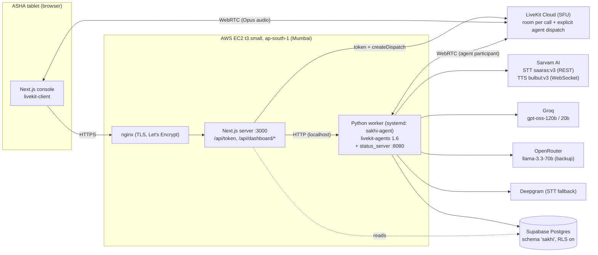
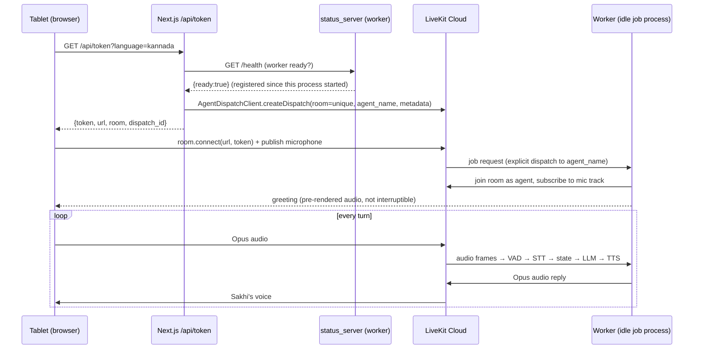

# Sakhi — Architecture, System Design and Build Guide

> Audience: an engineer (or an AI agent) who has to **understand, operate, or rebuild** a
> real-time multilingual voice agent of the same kind and with the same latency.
> Everything below describes the system as it runs in production (October 2026), with the
> measured numbers. Where a design choice came from a production incident, the incident is
> named so you do not have to rediscover it.

---

## 0. What Sakhi is, in one paragraph

Sakhi is a voice agent that walks an ASHA (village health) worker through a 24-question
antenatal screening in **Kannada or Hindi**, records the answers into a database, computes a
pre-eclampsia / danger-sign risk level with **deterministic rules**, and escalates when the
rules say so. The browser on a tablet talks to the agent over **WebRTC via LiveKit**. A Python
worker built on **livekit-agents 1.6** runs the pipeline:
`VAD → STT (Sarvam) → deterministic state machine → LLM (Groq) → TTS (Sarvam, streaming)`.
The single most important design principle:

> **The LLM handles language. The application handles state. Deterministic clinical rules
> handle safety.** The model never decides which question comes next, whether an answer is
> valid, or how risky a reading is.

---

## 1. System at a glance



| Layer | Technology | Code |
|---|---|---|
| Client | Next.js 16 / React 19, `livekit-client`, `@livekit/components-react` | `frontend/src/app/page.tsx`, `frontend/src/components/*` |
| Media transport | LiveKit Cloud (SFU), WebRTC, Opus | — |
| Call setup | Next.js route `/api/token` (LiveKit server SDK) | `frontend/src/app/api/token/route.ts` |
| Agent runtime | `livekit-agents==1.6.10` worker, job-per-call subprocesses | `agent.py` |
| VAD / turn detection | Silero VAD ×2, LiveKit `MultilingualModel` turn detector, adaptive endpointing | `agent.py` (`_build_vad`, `_build_stt_segmentation_vad`, `build_turn_handling`, `DynamicVADController`) |
| STT | Sarvam `saaras:v3` REST per utterance (primary), Deepgram (fallback) | `sarvam_wrappers.py` (`SarvamBatchSTT`), `agent.build_stt` |
| LLM | Groq `gpt-oss-120b`/`20b` (2 keys), OpenRouter backup, hedged | `agent.build_llm`, `llm_hedge.py` |
| TTS | Sarvam `bulbul:v3` streaming WebSocket + disk cache | `sarvam_wrappers.py` (`SarvamTTS`), `tts_audio_cache.py` |
| Deterministic core | intake state machine, extraction, validation, triage, guardrails, question lock | `sakhi_intake.py`, `sakhi_domain.py`, `sakhi_triage.py`, `guardrails.py`, `sakhi_question_lock.py`, `clinical_terms.py` |
| Tools the LLM may call | recording tools bound to the repository | `sakhi_tools.py` (`ClinicalToolset`) |
| Persistence | Supabase Postgres via `psycopg` 3 pool; SQLite for tests | `sakhi_sql_repository.py`, `sakhi_schema.py` |
| Telemetry | JSONL pipeline log, per-turn latency, component health | `agent.pipeline_event`, `sakhi_telemetry.py`, `status_server.py` |
| Hosting | EC2 + nginx + systemd; S3-staged, SSM-run gated deploys | `deploy/aws/` |

---

## 2. WebRTC system design

### 2.1 Why LiveKit (SFU) and not a raw WebRTC peer to the server

* The agent is just another **participant** in a room; LiveKit handles ICE/TURN, NAT traversal,
  jitter buffers, Opus, packet-loss concealment and reconnection. Rural 4G loses packets —
  this is not something to hand-roll.
* The worker connects **outbound** to LiveKit Cloud (no inbound UDP ports on EC2).
* Rooms are isolated per call, which gives per-call state isolation for free.

### 2.2 Call setup sequence



Key decisions (each one fixed a real problem):

1. **One unique room per call** (`sakhi-room-<random>`): guarantees a fresh agent job; no state
   bleed between calls.
2. **Explicit dispatch** (`createDispatch(room, AGENT_NAME, {metadata})`), not automatic
   dispatch: the token route decides exactly which worker gets the call and passes call
   metadata (language, voice, caller phone, tuning) that the worker reads in `entrypoint`.
3. **Readiness gate before dispatch.** The token route refuses to start a call if the worker
   is not registered with LiveKit ("Worker not ready yet"). Readiness = *a "registered
   worker" log line since the current process started, and no disconnect after it.*
   (Incident 2026-09-27: an age-based rule — "registration older than 24 h = stale" — blocked
   every call on a healthy worker that had simply been up for a day.)
4. **Prewarmed idle job processes** (`num_idle_processes=1`, `prewarm_fnc`): Silero VAD, the
   repository and triage engine are loaded once per process, so a call does not pay model load
   time. Each job process uses ~750–800 MB; on a 2 GB instance keep **one** idle process and
   **never run a second worker** next to production (it OOM-killed production once).
5. **Greeting from a pre-rendered cache** (`load_cached_greeting`, keyed by voice + language +
   text hash + pace): first audio of the call costs ~3 ms instead of a TTS round trip. The
   greeting is `allow_interruptions=False` (incident 2026-09-28: tablet-speaker echo cut it
   mid-sentence).
6. **Bounded wait for the caller's audio track** (≤1.5 s) before the greeting, so the first
   words are not spoken into a room nobody is listening to yet.
7. **Reconnect grace**: a WebRTC transport reconnect is not a new conversation — the session is
   not closed and the intake is not restarted.

### 2.3 Audio path details

* Browser publishes Opus mic audio (48 kHz) with the browser's own echo cancellation/AGC.
* Worker receives decoded PCM; **no server-side noise cancellation** in production
  (`NOISE_CANCELLATION=off`): LiveKit BVC erased every voice not close to the mic (speaker-
  played answers never reached VAD), and `noise_cancellation.NC()` crashed on 24 kHz input.
* Agent TTS output is 24 kHz PCM published as an Opus track.

---

## 3. The per-turn pipeline and its latency budget

```
ASHA stops talking
  │  T0
  ├─ end-of-turn detection (VAD silence + endpointing + turn model) ....... p50 1001 ms  ← largest
  │  T1  final transcript committed
  ├─ deterministic gates + extraction + validation + state + triage ........ < 5 ms
  ├─ LLM first token (Groq gpt-oss-120b, hedged) ........................... p50  582 ms  p95 886
  ├─ first clause → TTS first audio (Sarvam WS streaming) ................... 400–520 ms (cold)
  │                                                     (disk-cache hit)    ~0–30 ms
  │  T7  first audio plays
  └─ end-to-end speech-end → first audio ................................... p50 1535 ms  p95 2418
```

Measured on production, ~190 turns (09-20 → 09-28). STT itself is fast (REST 0.25–0.43 s per
utterance) and overlaps the end-of-turn wait. **Deterministic turns** (closed yes/no answers
that the state machine resolves) skip the LLM entirely and speak the next question with
~0 ms decision time.

### What made it fast (in order of impact)

| Decision | Effect |
|---|---|
| TTS over **streaming WebSocket** instead of REST per clause | first audio ~1.6 s → 0.40–0.52 s |
| **Deterministic router**: closed answers ("ಹೌದು"/"ಇಲ್ಲ") skip the LLM | saves a full LLM round trip on ~40% of turns |
| **Hedged LLM** (start backup concurrently if primary has no first token by `hedge_delay`) | provider outage ~3.7 s → ~1.9 s; slow primary costs nothing |
| Small, constant **tool set** + **context pruning** (≤8 items / ≤500 tokens) + `max_tokens=200` | TTFT stays ~0.6 s for the whole call instead of growing |
| **Batch STT behind our own VAD** (one REST call per complete utterance) | 0.25–0.43 s per utterance, faster than the streaming final (0.63–0.69 s) and no dropped utterances |
| **TTS disk cache** for repeated clauses + pre-rendered greeting | repeated questions play instantly |
| **Prewarmed** job process | no model load at call start |
| Preemptive generation **off** | no wasted/duplicate replies (correctness > ~200 ms) |
| EC2 and providers in/near **Mumbai** | low network RTT to Sarvam, LiveKit edge, Supabase |

### Biggest remaining lever

End-of-turn detection (~1 s). It is a direct trade against "Sakhi talks over the ASHA mid-
sentence"; tune per question type with data, never globally.

---

## 4. Turn-taking design

Two **separate** Silero VAD instances — this is deliberate:

| VAD | Job | Production values |
|---|---|---|
| Turn VAD (`_build_vad`) | when has she finished her turn? | min silence 0.45 s, activation 0.35, prefix 0.15 s, min speech 0.15 s |
| STT segmentation VAD (`_build_stt_segmentation_vad`) | cut audio into whole utterances for STT | min silence **0.6 s**, activation 0.25, prefix **0.4 s** |

The STT VAD waits longer (so a breath does not split "ಇಪ್ಪತ್ತೆಂಟು" (28) into "20" + "8") and is
slightly more sensitive (so the turn layer never commits speech STT did not get).

Turn handling (`build_turn_handling`):

* Turn detector: LiveKit `MultilingualModel` (semantic end-of-utterance).
* Endpointing: `min_endpointing_delay=0.35`, `max=1.2`.
* `DynamicVADController` adapts the wait per question: FAST (yes/no) = base, HIGH_COGNITIVE_LOAD
  (name/age, recall questions) = 1.0 s, FRAGMENT_RECOVERY (she trailed off on a connective) =
  1.1 s. Uses `session.update_options()` — **never mutate the shared VAD object** (it is shared
  across concurrent calls in the process).
* Interruption: `min_duration=0.35 s`, `min_words=1`, `resume_false_interruption=True`,
  `false_interruption_timeout=1.5 s` (a one-word "no" can still barge in).
* **Preemptive generation off**: a speculative reply is generated before the turn is recorded,
  so it is computed against the still-armed question → repeated questions (incident 09-22).
* Business logic runs **only** in `on_user_turn_completed` (final turns). Interim transcripts
  are telemetry only.

Silence handling:

* **"Didn't hear" watchdog**: speech ≥0.6 s with no final transcript within 3 s → Sakhi says
  "ಕ್ಷಮಿಸಿ, ಸರಿಯಾಗಿ ಕೇಳಿಸಲಿಲ್ಲ…" + the armed question. Cancelled if she **resumed speaking**
  (long answers with pauses) or if the sound started **while Sakhi was speaking** (echo).
* **Empty STT segment** → wait 1.5 s for the rest of the answer before apologising.
* **Latent filler** ("ಒಂದು ನಿಮಿಷ…") only if the LLM has produced nothing after 1.2 s.

---

## 5. STT design

```
mic PCM → STT segmentation VAD → whole utterance → normalise gain → Sarvam REST /speech-to-text
                                                  (lift to -3 dBFS peak, max +30 dB, never attenuate)
```

* `SarvamBatchSTT` (`stt.STT`, non-streaming) wrapped in LiveKit `stt.StreamAdapter(stt, vad)`;
  `stt.FallbackAdapter([sarvam, deepgram])`.
* `saaras:v3`, `mode=transcribe` (returns Kannada script; `codemix` wrote "ವಯಸ್ಸು" as "YSU"),
  language `kn-IN` / `hi-IN`.
* Why not Sarvam's streaming socket: its **server-side VAD** decided what speech was and
  silently dropped whole utterances our VAD had heard; `high_vad_sensitivity` fragmented one
  answer into 3–4 finals. **Rule: one VAD owns segmentation.**
* Every utterance emits a `[SAKHI_STT_DEBUG]` record (duration, RMS/peak dBFS, gain, latency,
  transcript length + hash — never the text) so failures can be placed *before / inside /
  after* STT.
* Text then goes through `clinical_terms.canonicalise()`: Kannada/Hindi number words → digits
  ("ಇಪ್ಪತ್ತೆಂಟು" → 28, "ನೂರ ಇಪ್ಪತ್ತು ಮೇಲೆ ಎಂಬತ್ತು" → 120/80), BP separators, clinical terms.

---

## 6. LLM design

* **Chain** (`build_llm`): `groq gpt-oss-120b @key1 → @key2 → gpt-oss-20b @key1 → @key2 →
  openrouter llama-3.3-70b → llama-3.1-8b`, grouped (Groq group, OpenRouter group), wrapped in a
  **hedge** (`llm_hedge.py`): if the primary has no first token by `hedge_delay`, the backup
  starts concurrently; first first-token wins; the loser is cancelled. Measured by **first
  token**, not completion, because TTS starts on the first clause.
* `temperature 0.15–0.3`, `max_tokens 200`, context pruned to ≤8 items / ≤500 tokens with
  `ChatContext.truncate()` (never orphan a tool result). Clinical state is injected fresh every
  turn as a system block, so the model never re-derives state from a long transcript.
* **Tools** (`ClinicalToolset`): `record_patient_intake`, `record_gestational_age`, `record_bp`,
  `record_symptoms`, `record_anc_checkpoint`, `connect_smfmi_specialist`, `end_call`. The tool
  list is **constant for the whole call** and registered on the Agent at construction; the
  session gets none. Two production bugs taught this:
  * changing tools inside `llm_node` → "unknown AI function" (livekit executes tool calls
    against the list captured *before* `llm_node`);
  * bound methods are new objects per lookup → de-duplicate by **name**.
* Tools return a compact instruction block; **the code computes risk**, the model only speaks
  it. Tool fallback lines (spoken if the model returns a tool call but no text) are
  acknowledgement-only — they must never ask a question or close the call.
* **Question lock** (`sakhi_question_lock.QuestionLock`): the model may only acknowledge. The
  code drops any question the model writes (trigram similarity vs every questionnaire question,
  JSON/tool text, Latin-dominant sentences on Kannada calls) and appends the armed question
  **verbatim**. This is what stops paraphrased or invented clinical questions.
* **Reply rule chosen by code** (`_reply_format_instruction`): the turn handler records whether
  the answer was *accepted*, *not answered*, or *a BP to record*, and the model is told exactly
  that. The model never decides on its own that an answer was "not clear".
* Language: Kannada and Hindi only for the pilot (`SAKHI_ENGLISH_ENABLED=false`); every
  scripted line has hand-written Kannada and Hindi text.

---

## 7. TTS design

* `SarvamTTS` (`bulbul:v3`, speaker `shreya`, pace ~0.95, 24 kHz) with
  `capabilities.streaming=True`: AgentSession calls `stream()` → `SarvamTTSSynthesizeStream`
  over `wss://api.sarvam.ai/text-to-speech/ws`.
* Connect with **`send_completion_event=true`**; the stream ends on Sarvam's
  `{"type":"event","data":{"event_type":"final"}}`, counted against the number of flushes sent.
  Without it the stream can only end on silence — the old 0.25 s idle cut-off was shorter than
  the 235–249 ms gap between clauses and **dropped the last clause (the question)** in 1 of 4
  runs. The idle timeout (1.5 s) is now only a fallback.
* Text arrives clause by clause from `tts_node` (pre-speech guard: a sentence claiming a write
  that did not happen is replaced). Sanitised for TTS (slashes → "or", markup stripped).
* `CachedTTS` wraps the provider: `synthesize()` checks a disk WAV cache keyed by
  text+voice+language+pace; `stream()` passes straight through to the provider **and relays the
  provider's streamed `TTSMetrics`** (otherwise LiveKit's `FallbackAdapter` never sees TTS
  metrics and per-turn TTFA telemetry disappears).
* `FallbackAdapter([CachedTTS(sarvam), …])` pinned to the primary's sample rate.
* `SARVAM_TTS_STREAMING=false` falls back to REST + an eager clause tokenizer (one REST call per
  clause, first audio ~1.6 s).

---

## 8. The deterministic core — the state machine

Every final user turn runs **one** authoritative pipeline in
`SakhiAgent.on_user_turn_completed`:

```
FINAL TURN
  → dedupe by LiveKit message id (never by text: two identical answers can be legitimate)
  → canonicalise (numbers, BP, clinical terms)
  → gates: after-goodbye? side-talk to the patient? repeat request? backchannel? fragment?
           (gates never drop a turn that contains a number, symptom or yes/no)
  → extract: name/age, gestational age, gravida, BP, symptoms (negation-aware)
  → validate against the ARMED question's type
       invalid → keep the question armed, count a stall, reply "not caught" (STOP transition)
       valid   → record answer, mark complete
  → triage (TriageEngine.assess on recorded BP + symptoms + weeks)
       HIGH_RISK → lock the questionnaire, advisory + specialist hand-off
  → guardrails (emergency / self-harm / jailbreak / medication-advice scripts)
  → deterministic router: unambiguous closed answer → speak next question, no LLM
  → otherwise LLM (acknowledge only) + question lock appends the armed question
```

Key components:

* **Questionnaire** (`sakhi_intake.INTAKE_QUESTIONS`): 24 frozen `IntakeQuestion`s in 7 stages,
  each with Kannada + Hindi text, a pacing hint (FAST/SLOW) and optional `applicable_if`.
  `IntakeProgress` arms exactly one question at a time; only the armed question can be closed.
  `sync_from_state()` closes questions whose facts were recorded by tools/extractors
  (q01 name+age, q02 weeks, q04 gravida, **q06 only when a BP is actually recorded**, q09 when
  symptoms were screened).
* **Typed validation** (`validate_answer`): out-of-domain Latin text rejected; BP/weight need a
  number or "not measured"; yes/no needs polarity, a number, a symptom or the question's own
  words; everything else needs a real word after stripping fillers/greetings. **Stall escape**:
  the 3rd unclear reply closes the question as "(unclear, best-effort)" so a call can never
  loop forever.
* **Extraction** (`sakhi_domain`): `detect_symptoms` (Kannada/Hindi/English, negation window
  clipped at clause breaks and contrast words, affirmation-aware), `detect_gestational_age`,
  `detect_pregnancy_number` (ordinal vs parity aware), `detect_patient_demographics`.
* **Triage** (`sakhi_triage.TriageEngine`): BP thresholds + tier-1 danger signs → `ROUTINE /
  MODERATE / HIGH_RISK` with written reasons. Approved thresholds live only here.
* **Emergency lock**: once HIGH_RISK, `questionnaire_open(state)` is false; no code path that
  speaks may append a routine question; escalation is forced deterministically if the model
  does not call the tool.
* **Guardrails** (`guardrails.py`), run on the redacted text: PII redaction first; emergency
  phrases (negation-aware); medication **advice requests** vs medication **reports** (a report
  such as "iron and calcium only, no other medicine" is recorded, never refused).
* **Completion**: q17 is the closing statement; when it is spoken, intake is COMPLETED, the
  hangup is scheduled after playout, and further courtesy turns are ignored.

---

## 9. Data layer

* Supabase Postgres, private schema `sakhi`: `mothers`, `bp_records`, `symptom_records`,
  `teleconsults`, `call_reports`, `call_turns`, `pipeline_events`, `component_health`.
  RLS enabled; the schema is not exposed to the Data API; the worker logs in as a dedicated
  owner role `sakhi_runtime` (`search_path=sakhi`).
* `psycopg` 3 `AsyncConnectionPool` (2–10) via the **session pooler** (port 5432; the
  transaction pooler 6543 also works because `prepare_threshold=None`).
* The worker creates the schema itself (`sakhi_schema.schema_statements`, same DDL for SQLite
  and Postgres); `SAKHI_REPOSITORY=postgres` refuses to start without `DATABASE_URL`.
* Writes never block the voice path: clinical writes are awaited inside tools (fast), telemetry
  is batched by `TelemetryWriter` (`executemany`, one round trip per flush).

---

## 10. Observability

* `pipeline_event(stage, status, label, message, **details)` → `logs/pipeline_events.jsonl` +
  DB. Every turn emits `[SAKHI_TURN]` (question before/after, validation result and reason,
  answer status, extracted values without names, risk level, lock state) and `turn_latency`
  (`eou_delay_ms`, `stt_final_ms`, `llm_ttft_ms`, `tts_ttfa_ms`, `first_audio_total_ms`).
* `component_health` table → the `/admin` control room draws the pipeline (microphone,
  LiveKit, STT, turn, LLM, TTS, playback, database, worker) green / amber / red.
* `/admin` also has the live log and an **AWS costs** tab (Cost Explorer, cached 6 h).
* Never log transcript text in debug records — hashes and lengths only.

---

## 11. Development architecture

### Repository layout

```
agent.py                 worker: entrypoint, session wiring, turn handler, llm_node, tts_node
sakhi_intake.py          questionnaire + IntakeProgress state machine + typed validation
sakhi_domain.py          call state, extractors, danger-sign detection
sakhi_triage.py          clinical rules
sakhi_question_lock.py   verbatim question enforcement
sakhi_tools.py           LLM tools
guardrails.py            input/output safety
clinical_terms.py        number words, canonicalisation
sarvam_wrappers.py       STT (batch + socket), TTS (stream + REST)
tts_audio_cache.py       TTS disk cache + streaming pass-through
llm_hedge.py             hedged LLM
sakhi_sql_repository.py  Postgres/SQLite repositories
status_server.py         health, logs and dashboard HTTP API (inside the worker)
frontend/                Next.js console, /admin, /reports
deploy/aws/              provisioning, secrets, gated deploy, nginx, systemd
scripts/                 e2e_call_probe, live_llm_scenarios, stt_accuracy_probe, latency_report
tests/                   ~1,570 tests
```

### Local development

```bash
pip install -r requirements.txt && cp .env.example .env   # LIVEKIT_*, SARVAM_API_KEY, GROQ_API_KEYS
python agent.py download-files && python agent.py dev
cd frontend && npm ci && npm run dev
python -m pytest tests -q                                  # no network needed
```

### Testing strategy

* Unit tests for every extractor, validator, guardrail and rule — **every production bug
  becomes a test named after it** (e.g. `test_turn_reliability_2026_09_28.py`).
* `scripts/live_llm_scenarios.py`: full conversations through the real `SakhiAgent` and real LLM
  in text mode (calls `on_user_turn_completed` first, exactly like LiveKit).
* `scripts/e2e_call_probe.py`: a synthetic caller joins a real LiveKit room and plays a WAV as
  its microphone → the whole production path including WebRTC, VAD and STT.
* `scripts/stt_accuracy_probe.py`: N runs × conditions (clean, quiet, noisy, speaker-to-mic).

### Gated production deploy (`deploy/aws/` pattern)

1. Stage files to S3; run the script on the instance via SSM.
2. Back up the live files.
3. On a **scratch copy** of `/opt/sakhi` with the new files: `py_compile`, import, live STT gate,
   live streaming-TTS gate, and an **audit gate** (a full scripted intake through the real LLM
   with assertions).
4. Refuse if a call is in progress.
5. Swap, restart `sakhi-agent`, wait for "registered worker", check readiness through the site.
6. Automatic rollback on any failure. Frontend builds happen in a separate copy with a temporary
   swap file, then swap `.next` atomically.

---

## 12. Recipe: build the same kind of agent

1. **Transport**: LiveKit Cloud; Next.js route that (a) checks worker readiness, (b) creates a
   unique room, (c) explicitly dispatches your `agent_name` with metadata, (d) returns a token.
2. **Worker**: `livekit-agents` with `prewarm_fnc` (load VAD, repository) and
   `num_idle_processes=1`; region close to your users and providers.
3. **Two VADs**: a turn VAD (~0.45 s silence) and an STT segmentation VAD (~0.6 s silence,
   0.4 s pre-roll). Wrap a **non-streaming** STT in `stt.StreamAdapter` so *your* VAD owns
   segmentation; add a `FallbackAdapter`.
4. **Turn handling**: semantic turn detector, endpointing 0.35–1.2 s, adaptive per question
   type, preemptive generation off, interruption 0.35 s / 1 word with false-interruption resume.
5. **Deterministic core first**: write the questionnaire as data, a one-armed-question state
   machine, typed validators, extractors with negation handling, and the risk rules — with
   tests — *before* writing a prompt.
6. **LLM**: fast provider, hedged backup measured on first token, small constant tool set,
   pruned context, state injected per turn, the model only acknowledges; the code appends the
   next question verbatim; the code tells the model whether the answer was accepted.
7. **TTS**: streaming WebSocket with an explicit completion event; feed it clause by clause;
   cache repeated clauses and pre-render the greeting; make the greeting non-interruptible.
8. **Silence & echo**: watchdog for "spoke but no words" that ignores overlap with the agent's
   own speech and waits while she is still talking.
9. **Safety**: deterministic guardrails before the LLM (PII redaction, emergency phrases with
   negation, advice-vs-report for medicines); an emergency **locks** the flow.
10. **Telemetry from day one**: per-turn trace + per-turn latency (EOU, STT, TTFT, TTFA,
    end-to-end) + component health; measure p50/p95 before optimising anything.
11. **Ship with gates**: scratch-copy gates with real providers + a scripted end-to-end
    conversation + automatic rollback.

---

## 13. Incidents worth knowing (and the rule each one taught)

| Incident | Rule |
|---|---|
| Streaming STT dropped whole utterances; high VAD sensitivity split "28" into "20" + "8" | One VAD owns segmentation; batch STT per utterance |
| Near-silent tablet audio (−60 dBFS) → empty transcript → total silence | Normalise gain; never be silent — say "didn't hear" |
| BVC noise cancellation erased speaker-played voices; NC crashed on 24 kHz | No server-side NC unless proven on field audio |
| Changing tools in `llm_node` → "unknown AI function" | Constant tool set, de-duplicated by name |
| Preemptive generation asked the same question twice | Keep it off for state-machine agents |
| 0.25 s TTS idle cut-off dropped the final clause | End streams on an explicit completion event |
| Health check expired after 24 h uptime → every call refused | Readiness = registered since process start |
| Greeting cut mid-sentence by speaker echo | Greeting not interruptible; ignore overlap in the watchdog |
| "No other medicine" refused as medication advice; "no severe pain" played the emergency script | Guardrails must understand negation and report-vs-request |
| BP question closed on any text, then "BP not clear" + weight question | A typed field closes only when the typed value is recorded |
| After escalation, routine questions resumed | Every speaking path checks the emergency lock |
| A script spoke a question without arming it → asked twice | Whatever speaks a question must arm it |

---

## 14. Known limits

* End-of-turn wait (~1 s) is the largest latency item; reducing it risks talking over the ASHA.
* STT still mishears short words in noise (e.g. "ಇಲ್ಲ" → "ಎಲ್ಲಾ"); validators re-ask, but
  cannot recover meaning.
* No push-to-talk or speaker addressing; background ASHA↔patient talk is filtered only by
  wording (`is_side_talk`).
* Groq daily token limits are shared between testing and production — use a separate key for
  testing.
* Hindi texts and several Kannada scripts still need clinician / native-speaker sign-off.
